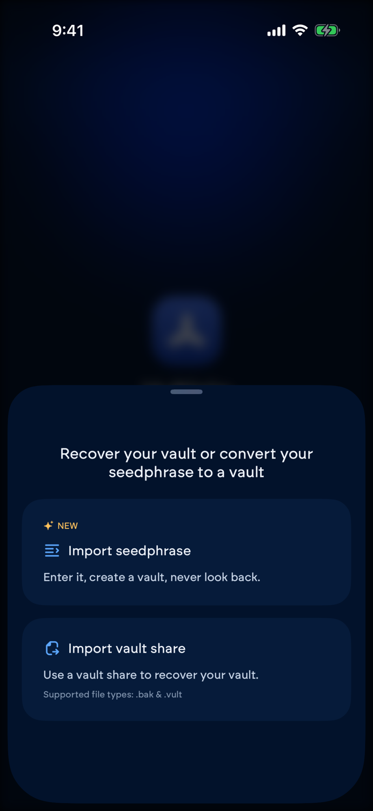
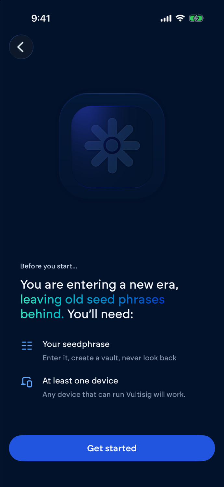
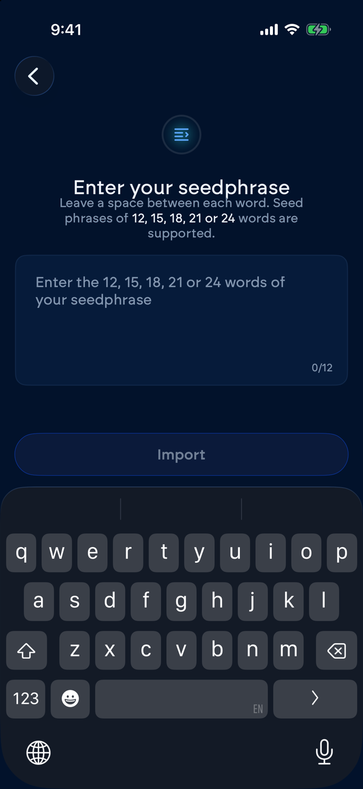
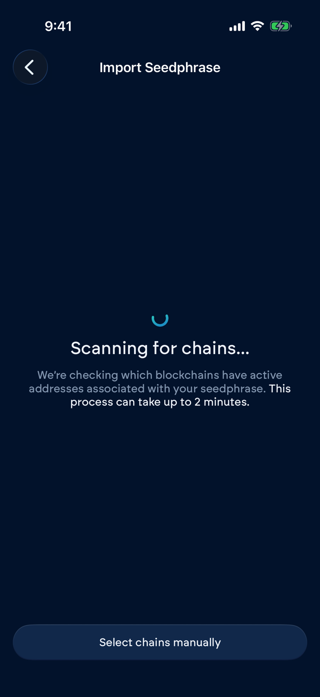
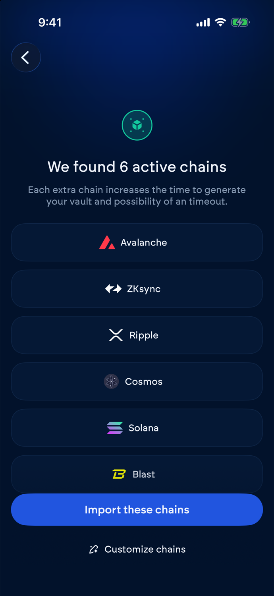
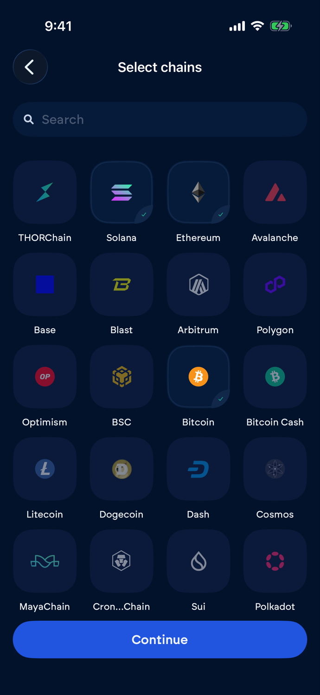
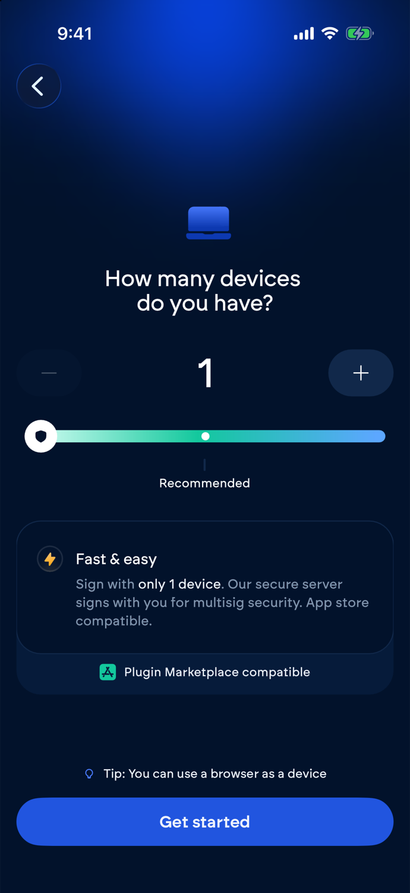

# Import a seed phrase into a Vultisig vault

Think of your seed phrase as the one key to a safe. Importing cuts that key into shares and gives one to each device in your vault. The safe stays where it is. Your addresses don't change, so your funds appear in the vault without a transfer.


Seed phrase import is in the iOS, Android, desktop, and browser extension apps. Downloads: [vultisig.com](https://vultisig.com/).


***

## Before you start

* **Your seed phrase.** 12, 15, 18, 21, or 24 words.
* **At least one device.** One device makes a [Fast Vault](fast-vault.md) with VultiServer. Two or more make a [Secure Vault](secure-vault.md). A browser running the Vultisig extension counts as a device.


**Your seed phrase still controls these funds after the import.**

The vault signs with the same keys, so anyone who has the words can move the funds without your devices. Keep the phrase as safe as before, or create a new vault and send your funds there.


***

## Import steps

<figure><figcaption></figcaption></figure>

1. Open Vultisig and tap **Import** on the start screen. Already have a vault? Add a new vault from the vault list to reach the same screen.
2. Select **Import seedphrase**.

<figure><figcaption></figcaption></figure>

3. Check that you have both items on the list, then tap **Get started**.

<figure><figcaption></figcaption></figure>

4. Type your words with a space between each one, then tap **Import**. The app checks the word count and every word before you move on.

<figure><figcaption></figcaption></figure>

5. Vultisig scans for chains with activity on your seed phrase. This takes up to 2 minutes. Tap **Select chains manually** to skip the scan.

<figure><figcaption></figcaption></figure>

6. Review the chains the scan found. Tap **Import these chains**, or **Customize chains** to pick your own.

<figure><figcaption></figcaption></figure>


**Pick every chain you hold funds on.**

An imported vault only signs on the chains you select here, and you can't add one later. Each extra chain adds time to vault creation and raises the chance of a timeout, so skip the chains you don't use.


<figure><figcaption></figcaption></figure>

7. Set how many devices you have and tap **Get started**. One device sets up a Fast Vault. Two or more set up a Secure Vault.
8. Finish setup the same way you create a new vault:
   * **Fast Vault:** name the vault, enter your email, and set a password. Steps: [Fast Vault](fast-vault.md).
   * **Secure Vault:** scan the QR code with your other devices. Steps: [Secure Vault](secure-vault.md).

Phantom stores Solana funds on a different address path. The scan checks both paths and uses the one that holds your funds.

***

## After the import


**Export a backup of every device share before you deposit more.**

A lost device with no backup means the funds are gone. See [Backup & Recovery](../../getting-started/backup-recovery.md).


***

## Troubleshooting

**Seed phrase is not correct** One or more words are misspelled or not on the standard word list. Check each word and its order.

**You entered the wrong number of words** The app accepts 12, 15, 18, 21, or 24 words. Count again and remove any extra spaces.

**Seed phrase already imported** A vault on this device already uses this seed phrase. Open that vault instead.

**No active chains found** The scan found no funds. Tap **Select chains manually** and pick the chains you plan to use.

**A chain is missing from your vault** The chain was not selected during import. Remove the imported vault from this device, then import the seed phrase again with that chain selected. The app won't import a seed phrase that a vault on the device already uses. In a Secure Vault, your other devices ask to replace their copy during setup. Your funds stay put. The seed phrase still controls them.
